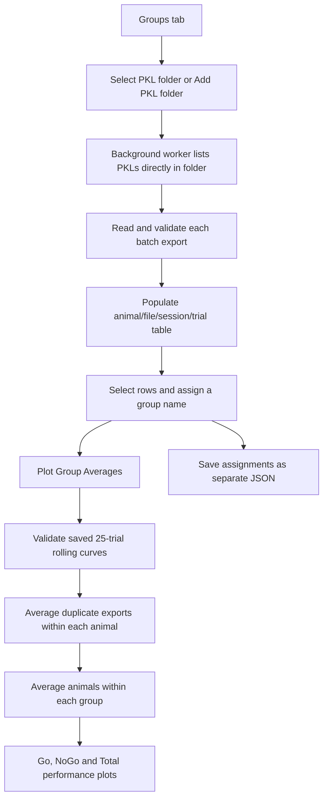

# Groups: load batch PKLs → assign groups → plot

Verified against local Behavior GUI v10 source on 2026-11-13. Scope: Go/NoGo → Groups, loading the animal batch PKLs created by Export batch data. This is a source-level trace; no GUI analysis was executed.

## Overview



## 1. Enter Groups and load PKLs

The standard batch loader selects a **folder**, rather than one individual PKL. It reads all `.pkl` files directly in that folder; it does not recursively scan subfolders.

```text
Groups tab selection
└─ _select_gonogo_layout() / _draw_selected_input_box()
   └─ _draw_groups_canvas(): render available group actions

Select PKL folder
└─ _load_group_folder(append=False)                      [behavior_gui_v10.py:1243]
   ├─ filedialog.askdirectory()
   └─ _start_group_load(folder=Path(selected), append=False) [1252]

Add PKL folder
└─ _load_group_folder(append=True)
   └─ same loader, retaining previously loaded exports and assignments

_start_group_load()
├─ guard against concurrent group loading
├─ set groups_loading=True; update status and redraw
├─ daemon thread → nested worker()
│  ├─ resolve folder; sorted(base.iterdir()) → direct .pkl files
│  ├─ queue start event
│  └─ for each path
│     ├─ resolve absolute path as dictionary/table key
│     ├─ reuse existing payload if already loaded in append mode
│     ├─ otherwise _read_group_export(path)
│     │  ├─ open(..., "rb") → pickle.load()
│     │  └─ validate batch export structure
│     ├─ check fields needed for table counts
│     └─ queue file event, or skip event with error text
└─ nested poll(), root.after(50, poll)
   ├─ start event
   │  ├─ Select: clear existing exports, assignments, rows and folder list
   │  └─ Add: preserve previous data
   ├─ file event
   │  ├─ add row: animal, filename, session count, trial count, Unassigned
   │  └─ store payload in group_exports[absolute_path]
   ├─ skip/error event → _write_output(); fatal error also shows dialog
   └─ done event
      ├─ clear loading flag; show added/duplicate/skipped counts
      └─ _refresh_group_assignments()
         ├─ update each table row's group label
         ├─ update group-name dropdown
         └─ _draw_selected_input_box() → _draw_groups_canvas()
```

Adding the same resolved file path again does not create another row or reread its contents. A different path is a different export, even if its animal name or filename matches. Selecting a new folder replaces the current list once the worker reaches its start event.

## 2. Export validation

`_read_group_export()` at `behavior_gui_v10.py:1227` requires these seven keys:

| Key | Loading check / use |
| --- | --- |
| `schema_version` | Must equal 1 |
| `animal_name` | Required; displayed in table |
| `performance_by_file` | Must be a dictionary; its length supplies session count |
| `trial_performance_by_file` | Required |
| `trials_by_sound_id` | Required |
| `hit_by_sound` | Required |
| `rolling_trial_data` | Must be a dictionary containing `trial_index`; its length supplies trial count |

These are initial structural checks. Rolling window size, curve lengths and animal identity are checked later when the group-average plot is requested. A PKL can therefore load into the table but fail plotting validation.

Loading restores previously calculated results. It does not load original NWBs, call `extract_performance()`, rerun IR/Licks analysis, or recalculate the saved rolling curves.

## 3. Assign loaded animals/files to groups

```text
Select one or more table rows; enter/select group name; Assign
└─ _assign_selected_group()                             [1381]
   ├─ reject empty selection/name and reserved name Unassigned
   ├─ reuse existing group spelling for case-insensitive name match
   ├─ group_assignments[file_path] = group_name
   ├─ _refresh_group_assignments()
   └─ log reminder to save assignments

Remove assignment
└─ _remove_selected_group()                             [1396]
   ├─ remove selected file keys from group_assignments
   └─ refresh rows and canvas; exports remain loaded
```

Assignments are per PKL path. Unassigned exports are excluded from group-average calculations. The assignment action itself does not prevent one animal's exports from being placed in different groups; plotting detects and rejects that conflict.

## 4. Plot Group Averages

```text
Canvas click: plot_group_averages
└─ _handle_main_canvas_pick()
   └─ _open_group_average_plot()                         [1439]
      └─ behavior_plots.plot_group_average_performance() [351]
         ├─ group_animal_curves()                        [305]
         │  ├─ skip unassigned exports
         │  ├─ require nonempty animal_name; casefold animal identity
         │  ├─ reject same animal assigned to multiple groups
         │  ├─ require rolling_trial_data.window_trials == 25
         │  ├─ require trial_index == [0, 1, ..., N-1]
         │  ├─ validate go_pct, nogo_pct, total_pct lengths
         │  └─ for each animal with multiple exports
         │     └─ _mean_aligned_curves() for each metric
         ├─ create Go, NoGo and Total axes using plot layout preferences
         ├─ draw individual-animal curves in grey
         ├─ _mean_aligned_curves(): group mean across animal curves
         ├─ draw group means in color with animal counts
         └─ plt.show(block=False); return figure
```

The plot uses **saved 25-trial rolling percentages**, aligned at cumulative trial index 0. It does not align animals by date or session number. Multiple exports for one animal are averaged at matching trial indices, rather than concatenated into a longer history. The group mean then gives each available animal equal weight at each index. Shorter curves stop contributing after their final trial; nonfinite values do not contribute. This is not a pooled-trial percentage.

Example: at the same cumulative trial index, animal A is at 80% and B is at 60%, so the group mean is 70%. If only A has data at a later index, the mean there is A's value.

No eligible assigned curves returns no figure and shows an information dialog. Invalid data or conflicting animal assignments produces an error dialog.

## 5. Save or restore group assignments

```text
Save assignments
└─ _save_group_assignments()                            [1409]
   ├─ _group_assignment_file_key(): relative path under base folder,
   │  otherwise absolute path
   └─ save JSON: schema_version, base_folder, assignments

Load assignments
└─ _load_group_assignments()                            [1430]
   └─ _start_group_load(manifest=chosen_JSON)
      ├─ worker validates JSON version, base folder and group names
      ├─ resolve referenced PKL paths against base folder
      ├─ load missing PKLs through _read_group_export()
      └─ poller applies group labels; null removes an assignment
```

Assignments are saved separately from the animal batch PKLs; assigning a group does not modify those PKLs. Loading an assignment JSON defaults to append mode, preserving exports already loaded. A missing or invalid referenced PKL is skipped and logged.

## 6. Other Groups buttons: separate follow-up workflows

These do not execute automatically when batch PKLs load:

| Button | Entry and next function | Purpose |
| --- | --- | --- |
| Plot Curves Single Animals | `_open_single_animal_curves()` → `group_learning.plot_group_learning_thresholds()` → `grouped_trial_batches()` | Learning curves and sigmoid-based 80% threshold estimates using 25-trial bins; stores figures, results and group statistics |
| Generate group files | `_generate_group_files()` → background `group_file_export.build_group_files()` | Writes separate group animal/session files into a new output subfolder; retains generated data and source paths |
| Load group trial data | `_load_group_trial_data()` → background `pickle.load()` and animal/session structure checks | Loads the separate group-file format containing animal dictionaries with `sessions` lists |
| First / last session fork duration | `_plot_first_session_fork_durations()` | Uses loaded group trial data for fork-duration analysis |

**Select PKL folder** expects Export batch data payloads. **Load group trial data** expects a different animal/session format. These loaders are not interchangeable.

## State after loading

| App attribute | Contents |
| --- | --- |
| `group_exports` | Resolved PKL path → full animal batch-export payload |
| `group_assignments` | PKL path → assigned group name; absent means Unassigned |
| `group_folder` | Base folder used for assignment paths and dialogs |
| `group_folders` | Loaded folder list shown in the GUI |
| `groups_loading` | Whether background loading is active |

Only loading and table/canvas refresh happen on import. Group calculations, figures and saved assignment JSON require their respective actions.
