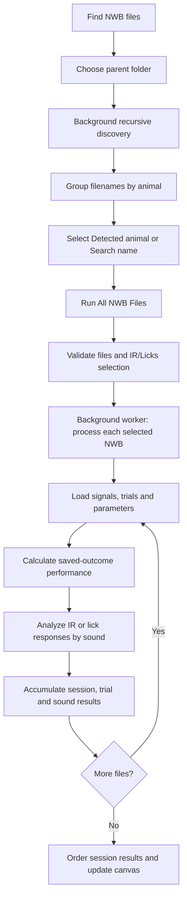

# Find NWB files → Run All NWB Files: function workflow

Verified from the current local source on 2026-11-13. Scope: Behavior GUI v10, Go/NoGo → Animal tab. This is a source trace, not an interactive execution. Function names without a module prefix below belong to `ScanMediaFoldersApp` in `behavior_gui_v10.py`, unless nested inside another function.

## Overview



## 1. Find and select NWB files

```text
Find NWB files button
└─ _find_nwb_files_for_animal()                         [behavior_gui_v10.py:795]
   ├─ filedialog.askdirectory(): choose parent folder
   └─ _start_gonogo_animal_search(folder, "nwb")        [810]
      ├─ _reset_session(): clear previous session/batch state
      ├─ clear discovery state; set loading flag and cancellation event
      ├─ _refresh_gonogo_animal_controls()
      ├─ _draw_selected_input_box() → _draw_animal_canvas()
      ├─ daemon thread → animal_work.scan_sessions()
      │  ├─ os.walk(): recursive traversal, without following directory links
      │  ├─ collect files with case-insensitive .nwb extension
      │  └─ queue progress, warning/error and completion events
      └─ nested poll(), scheduled with root.after(100, poll)
         ├─ discovery_status(): progress text; _write_output(): found paths
         └─ on completion
            ├─ store nwb_scanned_files and nwb_search_root
            ├─ _group_nwb_files()
            │  └─ _infer_animal_name_from_nwb_filename() for each path
            ├─ populate Detected animal dropdown; report unidentified paths
            ├─ discovery_complete(): completion text
            └─ refresh controls and redraw canvas

Detected animal selection
└─ _select_nwb_group()                                 [742]
   ├─ _reset_session()
   ├─ animal_var = selected animal
   ├─ found_nwb_files = files belonging to selected animal
   └─ update labels, print selected paths and redraw

Alternative: Search name
└─ _search_nwb_animal_override()                       [758]
   └─ case-insensitive substring match against all scanned full paths,
      including unidentified files → found_nwb_files
```

Animal inference recognizes `sub-...` / `sub_...`, `M` followed by digits, and animal prefixes before session or YYYYMMDD suffixes. Grouping is case-insensitive. Discovery does not load NWB contents or run analysis. Selecting an animal is a separate required step for automatic grouping.

## 2. Run the selected animal's NWB files

```text
Canvas click: run_all_nwb
└─ _handle_main_canvas_pick()                          [1774]
   └─ _run_all_found_nwb_files()                       [880]
      └─ _start_gonogo_animal_batch(tuple(found_nwb_files), "nwb") [886]
         ├─ guard: no active discovery/batch, nonempty files, IR or Licks chosen
         ├─ clear four batch dictionaries
         ├─ capture hit source and generation; set running/progress state
         ├─ daemon thread → nested worker()
         │  └─ for each selected file, sequentially
         │     ├─ load_session_data_fromFile(path)
         │     ├─ extract_performance(session)
         │     ├─ session_order.session_start_time(session)
         │     ├─ analyze_session_responses(session, hit_source)
         │     ├─ build trial correctness: Go → Hit; NoGo → CR
         │     │  └─ DMTSOutcome override when present
         │     ├─ _append_trials_by_sound_id()
         │     │  ├─ _get_session_date()
         │     │  └─ _to_builtin(): serialize each trial row
         │     ├─ _merge_hit_by_sound(): accumulate counts and recalculate %
         │     └─ queue OK or ERROR log; continue after a file error
         └─ nested poll(), scheduled with root.after(100, poll)
            ├─ display queued logs/progress on GUI thread
            └─ completion → assign batch dictionaries and errors
               └─ _finish_gonogo_nwb_batch()            [991]
                  ├─ session_order.ordered_sessions()
                  │  └─ session_sort_key(): session_start_time in UTC
                  ├─ align trial dictionary order to session results
                  ├─ animal_work.batch_complete(): success/skipped summary
                  ├─ print trial counts and response percentages by SoundId
                  └─ update status and redraw canvas
```

The worker checks its generation between files; stale polling callbacks are ignored. Files are analyzed in the selected path order, then session performance and trial dictionaries are ordered chronologically. Missing/invalid timezone-aware session timestamps sort after valid timestamps, with path as the fallback. Sound-grouped trial lists retain processing order.

## 3. Functions that load one NWB

In `behavior_functions.py:222`:

```text
load_session_data_fromFile(path)
└─ nwb_obj.session_data_nwb(nwbfile=path)
   ├─ __init__(): retain file path and check h5py availability
   ├─ read_paths()
   │  └─ _all_dataset_paths() → nested _visitor(): enumerate HDF5 datasets
   ├─ extract_continuous_signal()
   │  └─ read SoundCopy, WhichSound, Reward, TrialType, IRFork;
   │     retain available LeftLick/RightLick and timing metadata
   ├─ generate_results_table()
   │  └─ decode HMCF outcomes and trial types; create Hit/Miss/CR/FA,
   │     SoundId and trial IDs; retain optional trial timing and DMTS fields
   └─ get_parameters()
      └─ read parameter key/value pairs, creation date and session_start_time
```

The loader returns `parameters`, `session_start_time`, `signals`, `dataIR`, `trialID`, `sound_signal`, `ResultsTable`, and `nTotalTrials`.

## 4. Functions that analyze one session

### Session performance: saved trial outcomes

`behavior_functions.extract_performance()` checks `dmts_analysis.is_dmts_lick()` first. For ordinary Go/NoGo sessions it normalizes/persists `TrialType`, then calculates:

- `go`: percentage of Go trials with saved `Hit=1`.
- `nogo`: percentage of NoGo trials with saved `CR=1`.
- `total`: balanced mean of Go and NoGo percentages; Go percentage alone if no NoGo trials exist.
- `n_go`, `n_nogo`: category counts.

No Go trials or an empty ResultsTable causes a file error. These percentages come from the saved outcomes, independently of the selected IR/Licks response calculation.

### Response analysis: selected signal source

```text
behavior_functions.analyze_session_responses(session, hit_source)
├─ dmts_analysis.is_dmts_lick(session)
│  └─ if true: dmts_analysis.analyze_dmts() → hit_by_sound
└─ otherwise: detect_ir_events(dataIR.full)
   ├─ IR
   │  ├─ analyze_ir_by_trial()
   │  │  └─ _ir_stay_threshold_ms()
   │  │     └─ read_params() when parameters are a DataFrame
   │  └─ extract_hit_by_sound_IR()
   └─ Licks
      ├─ analyze_lick_events_by_trial()
      └─ extract_hit_by_sound_licks()
```

`detect_ir_events()` uses derivative thresholds to detect event starts/ends. IR analysis groups events into trial windows and calculates occupancy; the response threshold comes from `hit_threshold_percent`, `HITThreshold_percent` or `percIRFork`. Missing or invalid thresholds cause an IR file error. Licks analysis groups event starts into trial windows and counts a response when at least five events occur. Its current implementation excludes first/last trials from event grouping, while the sound percentage denominator includes all trials of that SoundId.

Dual-lick DMTS recognition takes precedence over IR/Licks selection; `extract_performance()` also dispatches such sessions to `analyze_dmts()`. This is a conditional alternative within this Go/NoGo entry point; the separate DMTS tab has its own workflow.

## 5. Results retained after completion

| App attribute | Contents |
| --- | --- |
| `batch_performance_by_file` | Successful file → Go/NoGo/total percentages, trial counts and session timestamp |
| `batch_trial_performance_by_file` | File → `trial_type` and `correct` arrays; unscored entries are NaN |
| `batch_trials_by_sound_id` | SoundId → trial records with date, filename, path, trial index and trial columns |
| `batch_hit_by_sound` | SoundId → pooled `n_trials`, `n_FAs`, `FAs_pct` |
| `_gonogo_batch_errors` | List of failed file paths and error messages |

`n_FAs` / `FAs_pct` are the existing key names used for the sound response metric in both IR and Licks modes. `_merge_hit_by_sound()` pools counts, rather than averaging session percentages, and does not retain per-session `allTrialsAsGO` lists.

Per-file failures are logged and processing continues. Aggregation is not transactional: an exception after trial records were appended could leave partial sound aggregates, even though that file is absent from successful session performance.

## 6. What runs only after another click

- Batch performance: `_open_batch_session_performance_plot()` → `behavior_plots.plot_batch_session_performance()`; rolling curves are calculated for that view.
- Export: `_export_batch_data()` creates the batch PKL after a save action.

Run All itself stores results in memory and updates the GUI; it does not automatically save a batch export or open a performance figure. It uses one selected IR/Licks setting for the whole batch and does not call per-file `_detect_nwb_hit_source()`.

The similarly named `run_nogui_nwb_batch()`, `_process_batch_session()` and `behavior_functions.run_nwb_batch_analysis()` are separate entry points, not calls made by these two GUI buttons.

